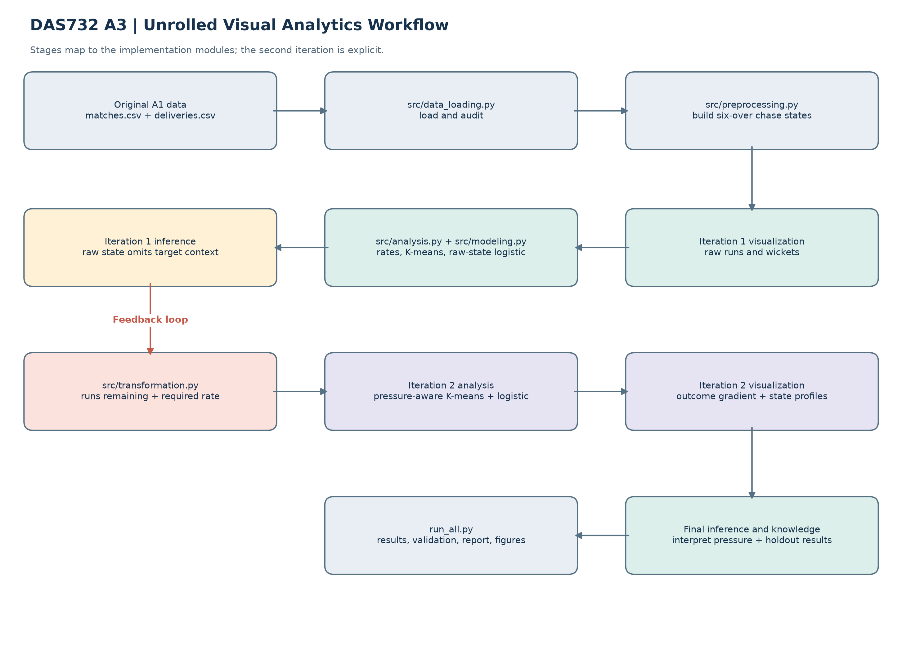

# IPL Chase Pressure: A Visual Analytics Workflow

**DAS732 Programming Assignment 3 · Team 3 · IIIT Bangalore**

This project studies whether an IPL team's score and wickets after six overs help explain whether it wins a chase, and whether the target-relative required run rate adds useful context. It is also an executable example of how a visual analytics project proceeds: prepare data, visualize and model it, form an inference, use that inference to revise the data representation, then repeat the analysis.



## The workflow, end to end

The workflow has two useful views:

1. **Cyclic view:** Data, visualization, modeling, and knowledge formation (inferences) inform one another. Bidirectional flows show interaction between stages; self loops show that a stage can be refined using its own results.
2. **Unrolled view:** The loop is expanded into the concrete order used in this project, including the inference that triggers the data update.

The project proceeds as follows:

```text
IPL match + delivery data
  → load, audit, and build eligible six-over chase states
  → visualize raw runs and wickets; analyze outcomes and recurring states
  → infer that raw score and wickets omit how much scoring remains
  → feedback: add runs remaining and required run rate to the state data
  → visualize pressure outcomes; repeat clustering and model comparison
  → record the final inference, limitations, and reproducible outputs
```

The knowledge nodes are **inferences** grounded in the analysis. The first inference is that two chases with the same six-over score can have different difficulty because their targets differ. The feedback transformation adds `runs_remaining` and `required_run_rate` to each match state. It preserves the match rows and outcomes, so the next iteration can evaluate what the added context changes.

The second iteration asks whether target pressure clarifies the observed outcome pattern and adds information to held-out prediction. This is an observational and predictive study; it does not claim that pressure causes a team to win or lose.

## Run the project

### Requirements

- Python 3.10 or newer
- Packages listed in [`requirements.txt`](requirements.txt)
- The five CSV tables from the companion Assignment 1 data: `matches.csv`, `deliveries.csv`, `match_players.csv`, `players.csv`, and `officials.csv`

The raw Assignment 1 tables are not included in this repository. By default, the pipeline looks for them at `../Assignment1/new_data/`, relative to this project folder. To use another location, set `IPL_DATA_DIR` to the directory containing all five CSVs.

```bash
python3 -m venv .venv
source .venv/bin/activate          # Windows: .venv\Scripts\activate
python -m pip install -r requirements.txt
export IPL_DATA_DIR="/path/to/new_data"  # Windows PowerShell: $env:IPL_DATA_DIR="C:\path\to\new_data"
python run_all.py
```

The pipeline writes processed/transformed tables, model metrics and predictions, validation and data-quality reports, figures, and a generated LaTeX report. Raw source files are read only. Use the existing `report/appendices/A1_Report.pdf` when generating the report; if it is absent, the generator expects to find the original A1 report beside the Assignment 1 data directory.

## How the analysis is organized

| Stage | What happens | Main implementation |
|---|---|---|
| Load and audit | Read the A1 tables, check schema, missingness, duplicates, and keys | `src/data_loading.py` |
| Prepare state | Build one eligible row per chase at the end of six overs | `src/preprocessing.py` |
| Iteration 1 | Summarize outcomes, cluster raw states, fit a time-split logistic model, and visualize runs/wickets | `src/analysis.py`, `src/modeling.py`, `src/visualization.py` |
| Form inference | Identify target context missing from raw six-over runs and wickets | `run_all.py`, documented in `report/main.tex` |
| Feed back to data | Derive runs remaining and required run rate at the six-over checkpoint | `src/transformation.py` |
| Iteration 2 | Visualize pressure, cluster target-aware states, compare models on the same later-date holdout | `src/analysis.py`, `src/modeling.py`, `src/visualization.py` |
| Report and artifacts | Orchestrate the full run, render the workflow, and generate tables and report | `run_all.py`, `src/workflow_render.py`, `src/reporting.py` |

The Mermaid source for the diagram is [`report/workflow.mmd`](report/workflow.mmd). The implementation-generated PNG is [`images/workflow_diagram.png`](images/workflow_diagram.png).

## Repository guide

- `src/` — data loading, preprocessing, analysis, modeling, visualization, transformation, workflow rendering, and report generation.
- `data/processed/` and `data/transformed/` — derived six-over match-state tables; no raw A1 tables.
- `outputs/results/` and `outputs/models/` — generated audits, validation, summary tables, cluster assignments, metrics, and holdout predictions.
- `images/` — figures used by the report and project presentation.
- `report/` — LaTeX report source, references, workflow Mermaid source, and A1 report appendix.
- `demo/` — presentation outline and narration script.
- `PLAN.md`, `LOG.md`, and `viva_prep.md` — project plan, implementation notes, and viva preparation.

## Reading the outputs responsibly

- Only standard, resolved, non-D/L matches with a complete six-over checkpoint are analyzed; ambiguous outcomes and chases ending before the checkpoint are excluded.
- The first model uses only six-over runs and wickets. The second adds required run rate, which is available at the checkpoint from the target, current score, and remaining legal balls.
- The chronological holdout tests on later match dates. Standardization is fit using training rows only.
- K-means labels are algorithmic summaries, not natural match categories. Results describe associations and predictions, not causal effects.
- Repeated source delivery rows are retained and flagged because the provided fields do not establish whether each repeated event is a duplicate record.

## For teammates

1. Get the A1 CSV files from the team's agreed source and keep them outside this repository.
2. Follow the setup commands above and set `IPL_DATA_DIR` on your machine.
3. Run `python run_all.py` from the project root to regenerate outputs.
4. Read `outputs/results/validation.md` and `outputs/results/data_quality.md` alongside the figures; use `demo/slide_outline.md` and `demo/narration_script.md` to understand the presentation story.
5. Before submission, confirm the team roster and contribution statement in the report, and review any generated changes before committing them.

## Assignment reference

The assignment prompt is included as `DAS732_T1-26-27_A3.pdf`. The report appendix contains the earlier A1 report for context; its older analysis is not presented as new A3 work.
